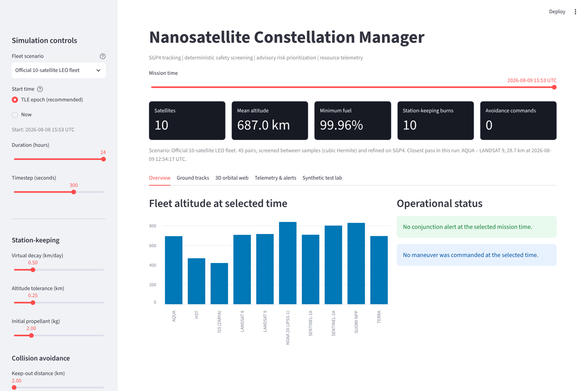
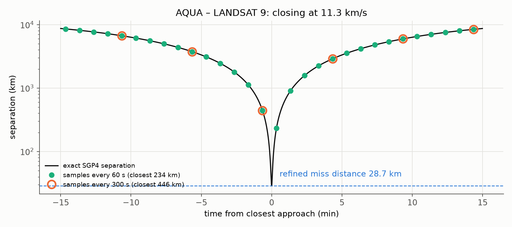
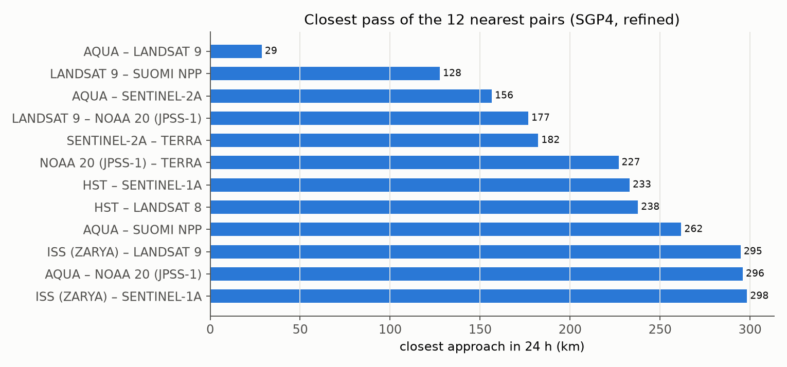
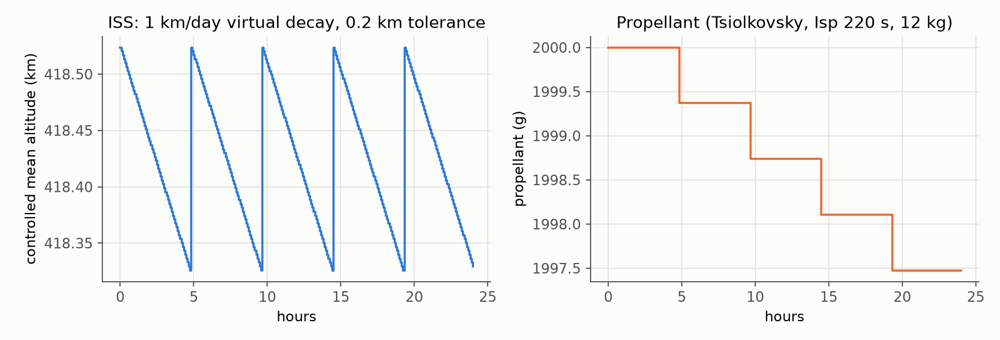

<div align="center">

# Nanosatellite Constellation Manager

*SGP4 tracking, station-keeping, conjunction screening and avoidance planning for a LEO fleet,
with a Streamlit command-center dashboard.*


[](LICENSE)

**Bishwaswarup Nayak** · Indian Institute of Science, Bengaluru

</div>

<p align="center"></p>

A simulation and decision-support demonstrator, **not** an operational collision-avoidance system. It
propagates real (archived) TLEs with SGP4, runs a virtual station-keeping controller with propellant
accounting, finds close approaches between every pair of satellites, plans a simple avoidance burn and
checks whether that burn actually opens the miss distance.

---

## Results on the archived 10-satellite fleet

ISS, HST, Terra, Aqua, Suomi NPP, Landsat 8 and 9, Sentinel-1A and -2A and NOAA-20, from CelesTrak TLEs
with epoch 8 Aug 2026, propagated for 24 h from the epoch. Numbers come from
[`scripts/make_report.py`](scripts/make_report.py) via [`results/report.json`](results/report.json).

| | |
|---|---|
| Closest pass of the day | **Aqua – Landsat 9, 28.7 km** at 12:54:17 UTC on 9 Aug, closing at 11.3 km/s |
| Screening between samples | cubic Hermite fit of the relative motion, then refinement on exact SGP4: within 0.4 km before refinement, and matching a 0.25 s brute-force search after it |
| A screen that only compares positions at each sample | sees that pair no closer than 70 km all day, even at 60 s steps; at that pass its nearest samples are 446 km (300 s) and 234 km (60 s) apart |
| Post-burn check, zero burn | reproduces the SGP4 miss distance exactly (28.68 km) |
| Station-keeping, 1 km/day virtual decay, 0.2 km band | 4 burns per satellite per day, 0.42–0.45 m/s, about 2.5 g of propellant on a 12 kg spacecraft |

<p align="center"></p>

*Two satellites crossing at 11 km/s are thousands of kilometres apart one sample before and after the
pass. Fitting the relative motion between samples finds the 28.7 km miss distance; sampling alone never
gets closer than a few hundred kilometres.*

<table>
<tr>
<td width="55%"><br><sub>Closest pass of the 12 nearest pairs in 24 h.</sub></td>
<td width="45%"><br><sub>Virtual decay and restoration burns for the ISS, and the propellant they cost.</sub></td>
</tr>
</table>

---

## What changed in this version

**Conjunction screening.** The first version compared positions only at the simulation timestamps. Two
LEO satellites close at 10–15 km/s, so at a 300 s step (or even 60 s) a real 28.7 km pass was invisible
and the dashboard's default 2 km keep-out could practically never trigger. Each pair is now screened
inside every interval with a cubic Hermite fit through the relative positions and velocities at both
ends, and every candidate within 25 km of the keep-out distance is refined by golden-section search on
the exact SGP4 separation to give the time and distance of closest approach. Adjacent intervals of one
pass are merged into one event.

**Post-burn re-screen.** The first version propagated the manoeuvring satellite with a two-body RK4
integrator and compared it with the other satellite's SGP4 position. Over six hours the two force models
differ by 28–430 km on this fleet, while a 0.01 m/s burn moves a satellite by about 0.7 km. Every plan
was therefore labelled `CLEARED`, with or without a burn (zero burn: 246 km "separation" for a 28.7 km
pass). The check now propagates the two-body arc twice, with and without the burn, and adds only the
difference to the SGP4 states at the time of closest approach. With this, the simple retrograde policy is
often `INSUFFICIENT`: a 0.5 m/s burn six hours before the Aqua – Landsat 9 pass moves Landsat 9 by 34 km
but leaves the miss distance at 28.6 km, because the displacement is mostly along the direction of
relative motion.

**Start time.** The dashboard defaulted to the current date, months after the archived TLE epoch, where
SGP4 errors grow by kilometres per day. It now starts at the TLE epoch by default.

The physics guide ([PDF](docs/physics_guide.pdf)) is updated to match.

---

## How it works

| Layer | Implementation |
|---|---|
| Orbits | SGP4 from TLEs (TEME), Astropy TEME → ITRS for ground tracks and altitude |
| Station-keeping | virtual mean-altitude decay; a two-burn Hohmann restore when it leaves the tolerance band; propellant from the rocket equation (Isp 220 s, 10 kg dry, 2 kg propellant) |
| Conjunction screen | every pair, every interval: cubic Hermite minimum of the relative motion, SGP4 refinement, merged passes, keep-out test |
| Avoidance plan | retrograde phasing burn Δv = clip((1.25 d_keep-out − d_miss) / lead time, 0.01, 0.5 m/s), six hours before closest approach, charged to the propellant budget |
| Post-burn check | RK4 two-body arcs with and without the burn; the difference is added to the SGP4 states at closest approach → `CLEARED` / `INSUFFICIENT` |
| Risk score | a fixed logistic formula of miss distance, current separation, relative speed and time to closest approach (coefficients set by hand on synthetic cases, not trained); used only to order alerts, never to decide them |
| Dashboard | Streamlit + Plotly: fleet overview, ground tracks, 3D TEME view, telemetry and alert log with CSV export, closest approach of every pair, a synthetic close-approach test |

---

## Run

```bash
git clone https://github.com/Bishwaswarup/nanosatellite_constellation.git
cd nanosatellite_constellation
python -m venv .venv && source .venv/bin/activate
pip install -r requirements.txt

streamlit run main.py               # dashboard
pytest -q                           # 24 tests, ~30 s
python scripts/make_report.py       # figures/ and results/report.json, ~1 min
```

```python
from datetime import timedelta
from src.propagation import load_tles, make_state_function, tle_epoch
from src.simulation import simulate_tle_constellation
from src.avoidance import closest_approaches

sats = load_tles("data/official_fleet_10.tle")
start = max(tle_epoch(s) for s in sats)
telemetry = simulate_tle_constellation("data/official_fleet_10.tle", start, duration_hours=24, step_seconds=300)
print(closest_approaches(telemetry, make_state_function(sats)).head())
```

## Repository layout

```
main.py                 Streamlit dashboard
src/propagation.py      TLE loading, SGP4, TEME → ITRS, TLE epoch, exact state function
src/control.py          station-keeping loop, Hohmann Δv, rocket equation
src/avoidance.py        Hermite screen, SGP4 refinement, closest approaches, avoidance plans
src/numerical.py        impulsive burn and RK4 two-body propagator
src/simulation.py       orchestration and the differential post-burn check
src/risk_model.py       advisory logistic risk score
src/test_scenario.py    synthetic close-approach test for the dashboard
data/                   archived CelesTrak TLEs (10-satellite fleet, 5-satellite sample)
scripts/make_report.py  figures and numbers for this README
docs/                   physics guide (PDF + LaTeX)
tests/                  24 pytest tests
```

## Limitations

- The TLEs are a frozen snapshot (epoch 8 Aug 2026), not live data; do not use the output operationally.
- Miss distances come from SGP4 alone, with no covariance or collision probability.
- The burn's effect is computed with two-body dynamics (no J2 or drag) over the six-hour lead.
- The avoidance policy is a fixed retrograde rule, not an optimiser; the re-screen shows when it fails.
- Station-keeping decay is a virtual parameter, not a drag model.

## License

MIT, see [LICENSE](LICENSE).
